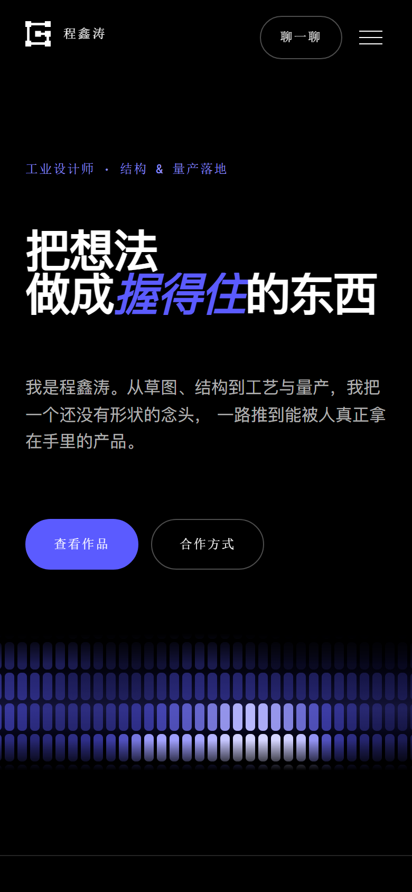

# 程鑫涛 · 工业设计师 — 个人作品集

一个纯静态单页作品集，视觉风格参照 [grilledpixels.com](https://www.grilledpixels.com/ecommerce) 的设计语言重建：
纯黑底、大号流体字阶、等宽体标签、自定义缓动曲线、12 列栅格、整屏强调色版块。

首页有 3 个真实项目，每个项目点进去是独立详情页，图片以**环形轮播**呈现。

两个 React Bits 组件已移植为无依赖原生实现：

| 组件 | 用途 | 移植说明 |
|---|---|---|
| `<MicroSlats />` | 首屏动态色带 | React + `ogl` → 原生 WebGL2 |
| `<CircularCarousel />` | 作品图片环形轮播 | React → 原生 DOM + CSS 3D |

**无构建步骤、无依赖、无框架。** 双击 `index.html` 就能打开。



---

## 文件结构

```
portfolio/
├── index.html               首页：作品卡片、能力、关于、联系
├── work-01.html             「蒜乐扒」儿童手摇剥蒜器
├── work-02.html             NetAce 网球智能陪练机器人
├── work-03.html             TESSAN 桌面多功能插座
├── styles.css               全站样式（设计令牌集中在 :root）
├── script.js                预加载、滚动揭示、导航、表单、图片灯箱
├── micro-slats.js           首屏色带（原生 WebGL2）
├── circular-carousel.js     环形轮播（原生 DOM + CSS 3D）
├── circular-carousel.css    环形轮播样式
├── work-carousel.js         详情页接入：把图集变成环形轮播
├── images/                  17 张作品图（WebP，共约 1.2 MB）
├── preview-mobile.png       移动端效果预览
├── README.md                本文件
└── tools/                   开发期脚本（部署时可整目录删掉）
    ├── cdp.py               极简 CDP 客户端（仅标准库）
    ├── deploy.mjs           通过 GitHub API 部署
    ├── optimize_works.py    原始作品图 → WebP
    ├── smoke.py             首页交互自检：26 项
    ├── verify_slats.py      色带自检：渲染 / 动画 / 交互
    ├── verify_carousel.py   轮播自检：四个 preset / 点击 / 溢出
    ├── verify_work_pages.py 三个详情页自检
    └── shot.py              按指定视口截图
```

`tools/` 里的脚本只在本地开发时用，部署时不必上传。
它们需要有 Edge 浏览器；Python 用工作区自带的那份即可。

```powershell
$base = "file:///C:/你的路径/portfolio/"

# 首页交互自检（导航、浮层、表单、横向溢出、锚点等 26 项）
python tools/smoke.py "$($base)index.html" 1440 900
python tools/smoke.py "$($base)index.html" 390 844

# 色带自检（着色器报错、实际像素、动画推进、指针交互）
python tools/verify_slats.py "$($base)index.html" 1440 900

# 三个详情页的环形轮播自检
python tools/verify_work_pages.py $base 1440 900

# 截图核对版式；末尾加 motion 保留动画
python tools/shot.py "$($base)work-01.html" 1440 1500 shot.png motion
```

---

## 还需要你确认的 3 处

| # | 位置 | 现在的内容 | 说明 |
|---|---|---|---|
| 1 | `index.html` 联系版块 + 联系浮层 | `hello@example.com` | **必改**：换成你的真实邮箱，或删掉这一整项。搜索 `data-placeholder` 可定位 |
| 2 | `index.html` 首屏数据带 | 8 年 / 40+ / 12 / 100% | 我按行业常见值填的，**不是你说的数字**，请改成真实的 |
| 3 | `index.html` 关于版块 | 工具：SolidWorks · Rhino · KeyShot | 我按工业设计常见工具填的，请改成你实际用的 |

已经填好的：所在地 **湖南 · 长沙**、电话/微信 **15571570741**、3 个作品及其全部图集。

### 新增作品

**首页加卡片**：复制 `index.html` 里任意一段 `<article class="project reveal">` 改文案即可，
`href` 指向新的详情页。

**加详情页**：复制一个现成的 `work-0N.html`，改标题、参数栏和 `<ul class="gallery-source">`
里的图片数据即可。图片放 `images/`，然后用压缩脚本批量转 WebP：

```powershell
# 把 D:\mj\作品图 的原始 PNG 压成网页用 WebP（改脚本顶部的 SRC 路径）
python tools/optimize_works.py
```

详情页的图片列表是数据驱动的，每一项长这样：

```html
<li data-src="images/work-01-cover.webp"
    data-alt="给读屏软件的图片描述"
    data-title="主视觉" data-subtitle="副标题"></li>
```

---

## 改配色

所有颜色都在 `styles.css` 顶部的 `:root` 里，改一处全局生效：

```css
:root{
  --black:#000000;      /* 背景 */
  --white:#ffffff;      /* 正文 */
  --accent:#5B5BFF;     /* 电光蓝紫：标题强调、按钮、整屏版块 */
  --accent-soft:#8f8fff;/* 小标签用的浅一档蓝紫 */
}
```

改成红色 `#EE344A` 就是参考站原本的配色。想试纯蓝灰可以把 `--accent` 设为 `#2E7BFF`。

改完 `--accent`，**首屏色带会跟着一起变** —— 它默认从 `--accent` / `--black` / `--white` 读色。

---

## 首屏动态色带（MicroSlats）

来自 React Bits 的 `<MicroSlats />`。原版是 React + `ogl`；
本项目是**零构建的静态站**，所以把实现逐行移植成了无依赖的原生 WebGL2：

| 原始实现 | 本项目的等价物 |
|---|---|
| React `useRef` / `useMemo` / `useEffect` | 闭包与工厂函数 |
| `ogl` 的 `Renderer` / `Program` / `Mesh` / `Triangle` / `RenderTarget` / `Texture` | `micro-slats.js` 里的 `microGL` 极简封装 |
| GLSL 着色器、preset 数值、流体物理参数 | **逐字保留，未做任何改动** |

移植后行为与原版一致：4 个 preset、波浪参数、指针搅动流体、点击溅射、
`intro` 展开动画、`prefers-reduced-motion` 降级。

### 调参数

参数写在 `index.html` 的容器属性上，改完刷新即可：

```html
<div class="hero__field"
     data-micro-slats
     data-slats-preset="swell"        <!-- swell | tide | storm | signal -->
     data-slats-color="#5B5BFF"       <!-- 留空则跟随 --accent -->
     data-slats-background="transparent"
     data-slats-width="9"             <!-- 单条色带宽度（CSS px） -->
     data-slats-height="26"
     data-slats-gap="3"
     data-slats-roundness="0.85"      <!-- 0 方形，1 全圆角胶囊 -->
     data-slats-speed="0.6"           <!-- 0 冻住海浪，指针仍能搅动 -->
     data-slats-scale="1.6"           <!-- 越大波浪越长越平缓 -->
     data-slats-chop="0.5"            <!-- 波峰更尖、波谷更平 -->
     data-slats-perspective="0.72"    <!-- 0 是平墙，越大越向地平线后退 -->
     data-slats-fog="0.5"
     data-slats-cursor-strength="1.1"
     data-slats-cursor-size="46"      <!-- 指针搅动的半径 -->
     data-slats-swirl="0.18"          <!-- 涡旋强度 -->
     data-slats-trail="1.6"           <!-- 痕迹残留秒数 -->
     data-slats-lean="0.5"            <!-- 色带随水流的倾斜 -->
     data-slats-glint-strength="0.8">
</div>
```

属性名与 React 版的 prop 一一对应，只是把驼峰换成连字符：
`cursorStrength` → `data-slats-cursor-strength`，`glint` → `data-slats-glint-strength`。

色带的高度在 `styles.css` 里调：

```css
.hero__field{ height:clamp(13rem,17vw,20rem); }
```

### 用代码控制

```js
const slats = document.querySelector('[data-micro-slats]').__microSlats;
slats.set({ color:'#EE344A', speed:1.2 });   // 等价于 React 侧改 props
slats.destroy();                             // 销毁并释放 WebGL 资源
```

也可以不用自动初始化，直接调工厂函数：

```js
const slats = MicroSlats.create(document.querySelector('#myBox'), {
  preset: 'storm', color: '#5B5BFF', slatWidth: 8, interactive: true,
});
```

### 性能

- 渲染分辨率有像素预算上限（`PIXEL_BUDGET`），高分屏不会硬拉满 DPR
- 只有可见（`IntersectionObserver`）且需要更新时才跑 `requestAnimationFrame`
- 切到后台标签页自动停帧
- 手机窄屏自动收细色带（`max-width:700px`）

### 兼容性

需要 WebGL2，不支持时会直接跳过并露出 CSS 静态渐变兜底（不会报错、不会白屏）。
指针的流体搅动还需要浮点渲染目标扩展（`EXT_color_buffer_float`）；
没有该扩展时海浪照常，只是少了指针搅动。

---

## 作品图片环形轮播（CircularCarousel）

来自 React Bits 的 `<CircularCarousel />`。原版是 React，本项目移植为**无依赖的原生实现**：

| 原始实现 | 本项目的等价物 |
|---|---|
| `useState` / `useRef` / `useMemo` / `useLayoutEffect` | 实例字段、闭包与显式的 setup / teardown |
| JSX 卡片与贴片渲染 | 原生 DOM 构建 |
| 组件 CSS | **逐字保留**，类名 `circular-carousel__*` 与变量 `--cc-*` 未改动 |

环的几何计算（`TILES` 分片、`radius`/`curve` 插值、弹簧阻尼、拖拽惯性、视差）
与上游一致，四个 preset 都可用。

### 交互方式

- **自动旋转**：默认 `drift` 缓慢自转，鼠标悬停时停住
- **拖动/抛掷**：按住拖动，松手有惯性并吸附到最近一张
- **点击卡片**：把那张转到正面
- **键盘**：左右方向键切换，`Home`/`End` 跳到首尾
- **看大图**：点下方按钮打开灯箱，`←` `→` 切换，`Esc` 关闭
- **缩略图**：底部缩略图点击可快速跳转
- **触屏**：横向拖动，纵向滚动不受影响（`touch-action` 已处理）
- **降低动效**：系统开启 `prefers-reduced-motion` 时自动停转

### 调参数

改 `work-carousel.js` 里的这一段：

```js
CircularCarousel.create(stageHost, {
  preset: 'cylinder',     // cylinder | orbit | wheel | panorama
  intro: 'rise',          // assemble | rise | spin | none
  cardWidth: 300,         // 卡片宽度（px）
  aspectRatio: 16 / 10,   // 宽 / 高，图片按此裁切
  gap: 26,                // 卡片间距
  speed: 11,              // 自转速度（度/秒）
  autoplay: 'drift',      // drift | step | off
  depthFade: 0.62,        // 背面淡出强度
  cornerRadius: 12,       // 卡片圆角
  captions: true,         // 是否显示下方说明
  ...
});
```

也可以在详情页的容器上覆盖：

```html
<div class="carousel-host" data-carousel data-preset="orbit" data-card-width="260">
```

轮播区的高度在 `circular-carousel.css` 里调：

```css
.carousel-stage{ height:clamp(32rem,46vw,50rem); }
```

### 用代码控制

```js
const c = window.__workCarousel;   // 详情页的轮播实例
c.focusIndex(3);                   // 把第 4 张转到正面
c.stepBy(1);                       // 前进一张
c.set({ speed: 20 });              // 改参数
c.debug();                         // 当前状态快照
c.destroy();
```

想自己从头建一个：

```js
const c = CircularCarousel.create(document.querySelector('#myBox'), {
  items: [{ src: 'a.jpg', alt: '描述', title: '标题', subtitle: '副标题' }],
  preset: 'orbit', cardWidth: 260, captions: true,
});
```

> 注意：组件会撑满父元素，所以父元素**必须有确定的高度**，
> 否则环没有空间、什么都看不到。

### 性能

- 图片懒加载，只有可视区内的轮播才跑动画（`IntersectionObserver`）
- 切到后台标签页自动停帧
- 环只在容器尺寸变化时重新测量（`ResizeObserver`）
- 卡片上限 64 张（防止误传几百张把环压成一个点）；预加载上限 16 张

---

## 联系方式表单

表单目前**不发送到任何服务器** —— 纯静态页面没有后端。当前行为：

1. 校验称呼、联系方式、需求说明三项必填；
2. 通过后把内容整理成一段文本并**复制到剪贴板**，提示用户发到微信。

想让它直接发邮件，给 `<form>` 加一个属性即可，`script.js` 已经支持：

```html
<form class="contact__form" id="contactForm" data-mailto="你的邮箱@example.com" novalidate>
```

想用专业表单服务（推荐，能收附件、有后台记录）：注册 [Formspree](https://formspree.io) 之类的服务，
把 `action` 指向它，并删掉 `script.js` 里第 8 段表单逻辑。

---

## 本地预览

直接双击 `index.html` 即可。

想用本地服务器（避免个别浏览器对 `file://` 的限制）：

```powershell
cd portfolio
python -m http.server 8080
# 然后打开 http://localhost:8080
```

---

## 部署到 GitHub Pages

你有 `afsanaakther4889-code/Portfolio` 这个空仓库，可以直接用：

```powershell
cd <你的工作区>\portfolio
git init
git add .
git commit -m "个人作品集"
git branch -M main
git remote add origin https://github.com/afsanaakther4889-code/Portfolio.git
git push -u origin main
```

然后到仓库 **Settings → Pages**：

- Source 选 `Deploy from a branch`
- Branch 选 `main`，目录选 `/ (root)`
- 保存，等一分钟

访问地址：`https://afsanaakther4889-code.github.io/Portfolio/`

> 注意：仓库名是 `Portfolio`（大写），GitHub Pages 的路径大小写敏感，用上面这个地址。

---

## 无障碍与兼容

已经处理好的部分：

- 语义化标签、`<main>` 地标、跳转到主内容的 skip link
- 表单 `<label>` 关联、`aria-invalid`、`role="status"` 实时提示
- 联系浮层支持 `Esc` 关闭、关闭后焦点回到触发按钮
- 导航按钮有 `aria-expanded` 状态
- 尊重 `prefers-reduced-motion`：关闭动效时自动跳过预加载与滚动动画
- 有打印样式，打印时隐藏导航与浮层、强制深色字
- 断点：320 / 390 / 700 / 1024 / 1200 / 1400，栅格 2 → 6 → 12 列

已知取舍：字体使用系统字族（等宽体 + 无衬线体），不加载外部字体，
所以首屏没有字体下载等待，但不同操作系统的字形会有差异。
想统一字形可以自托管字体，在 `styles.css` 的 `--sans` / `--mono` 里替换。
